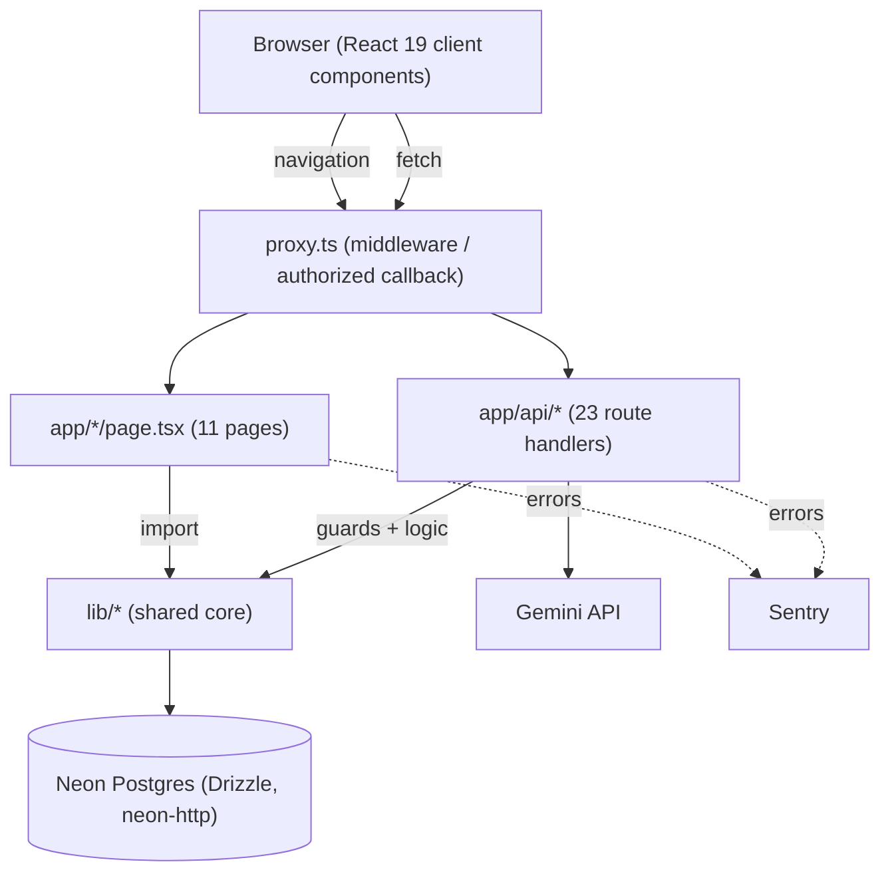
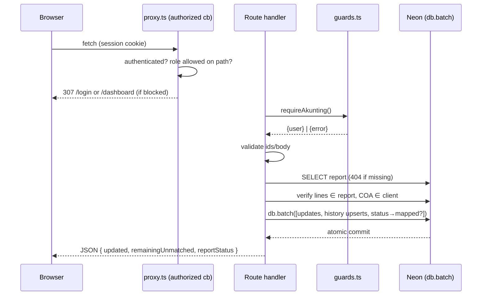
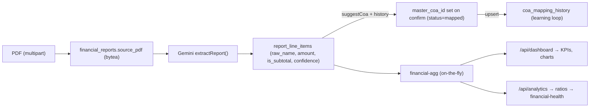
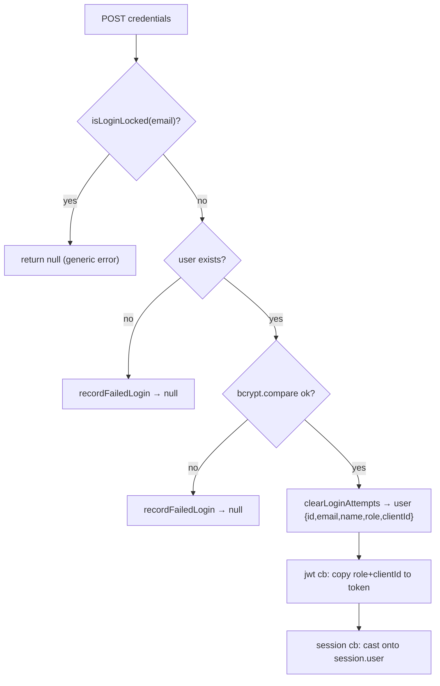
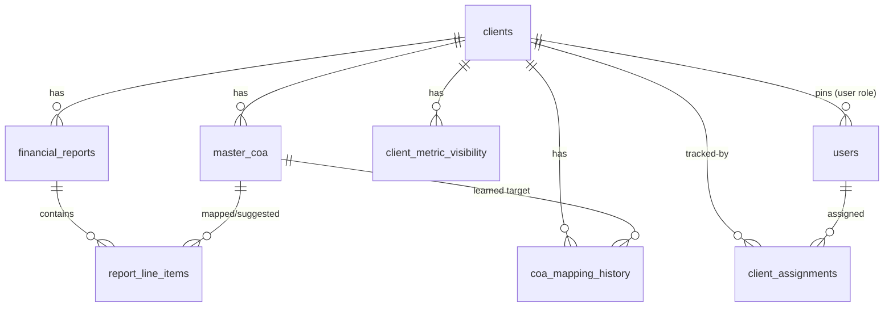

# NgitungID BI — Architecture

> **Status:** Living document describing the **actual** implementation as of 2026-07-23.
> Produced from a read-only, evidence-based analysis of the repository (no code was changed).
> The current implementation is the single source of truth. Statements are cited to files;
> anything not verifiable from the repo is marked **_Needs Verification_**.

## Table of Contents
1. [Project Overview](#1-project-overview)
2. [Business Goals](#2-business-goals)
3. [Technology Stack](#3-technology-stack)
4. [Repository Structure](#4-repository-structure)
5. [High-Level Architecture](#5-high-level-architecture)
6. [Frontend Architecture](#6-frontend-architecture)
7. [Backend Architecture](#7-backend-architecture)
8. [Folder Responsibilities](#8-folder-responsibilities)
9. [Module Responsibilities](#9-module-responsibilities)
10. [Request Flow](#10-request-flow)
11. [Data Flow](#11-data-flow)
12. [Authentication Flow](#12-authentication-flow)
13. [Database Design](#13-database-design)
14. [API Organization](#14-api-organization)
15. [External Integrations](#15-external-integrations)
16. [State Management](#16-state-management)
17. [Dependency Relationships](#17-dependency-relationships)
18. [Build Process](#18-build-process)
19. [Deployment](#19-deployment)
20. [Environment Configuration](#20-environment-configuration)
21. [Logging](#21-logging)
22. [Error Handling](#22-error-handling)
23. [Security Notes](#23-security-notes)
24. [Performance Considerations](#24-performance-considerations)
25. [Scalability Considerations](#25-scalability-considerations)
26. [Current Technical Debt](#26-current-technical-debt)
27. [Known Limitations](#27-known-limitations)
28. [Missing Documentation](#28-missing-documentation)
29. [Future Improvement Opportunities](#29-future-improvement-opportunities)

---

## 1. Project Overview
NgitungID BI is a **multi-client Financial Business Intelligence SaaS for Indonesian SMEs (UMKM)** ([`README.md`](README.md), [`PRODUCT.md`](PRODUCT.md), [`CLAUDE.md`](CLAUDE.md)). An accounting team (roles **owner** + **akunting**) uploads a client's financial reports as PDF; Gemini extracts the line items; each line is mapped to that client's Master COA; automated Dashboard and Analytics are generated. Clients (**user** role) get read-only access to their own data.

It is a **single Next.js App Router application** — frontend pages, backend API route handlers, and shared logic all in one deployable (a modular monolith), not a split front/back repo.

**Delivery status** (from [`ROADMAP.md`](ROADMAP.md)): Phase 1 (frontend), Phase 2 (backend/API + DB), and Phase 3 (Gemini extraction + AI COA mapping) are done; hardening (backups, CI, Sentry, RBAC, rate limiting, account management) is complete. The app is described as **technically release-ready but not yet deployed to Vercel** (pending a Pro-plan decision).

## 2. Business Goals
Turn raw client financial PDFs into automated, per-client dashboards with minimal manual effort ([`CLAUDE.md`](CLAUDE.md) business-flow):
1. **Client setup** → admin creates a client and imports that client's **Master COA** (Excel), which defines account classification (Posisi, Kelompok Laba Rugi/Neraca, Sub Kelompok, Class CF).
2. **Upload** → per client + period, three separate files (Laba Rugi / Neraca / Arus Kas) as PDF (kept separate to improve extraction accuracy).
3. **Extraction** → Gemini OCR/parse → per-line confidence.
4. **Extraction review** → admin edits low-confidence rows, rejects wrong ones, confirms.
5. **COA mapping** → each line mapped to Master COA; suggestions improve over time from history.
6. **Output** → Dashboard (KPIs, trends, P&L, expense, balance-sheet health, cashflow) + Analytics (liquidity/profitability/leverage/efficiency ratios with benchmarks and a 0–100 health score).

## 3. Technology Stack
Verified from [`package.json`](package.json), [`README.md`](README.md), [`ci.yml`](.github/workflows/ci.yml):

| Layer | Choice | Version |
|---|---|---|
| Framework | Next.js App Router | `16.2.6` |
| Language | TypeScript (strict) | `5.7.3` |
| UI | React | `19` |
| Styling | Tailwind CSS v4 (config in `globals.css` `@theme`, **no `tailwind.config`**) | `4.2.0` |
| Components | shadcn/ui (`components/ui/button.tsx` only), lucide-react, class-variance-authority, clsx, tailwind-merge | — |
| Charts | Recharts | `3.8.1` |
| DB / ORM | PostgreSQL (Neon serverless) + Drizzle ORM (`neon-http` driver) | orm `0.45.2`, kit `0.31.10`, neon `1.1.0` |
| Auth | NextAuth v5 (Credentials) + bcryptjs | `5.0.0-beta.31`, bcrypt `3.0.3` |
| AI | Google Gemini (`@google/genai`) | `2.10.0` |
| File parsing | `xlsx` (COA import); `papaparse` (declared, CSV path not built) | `0.18.5`, `5.5.3` |
| Errors | Sentry (`@sentry/nextjs`) | `10.65.0` |
| Tests | Vitest (node env, pure logic only) | `4.1.10` |
| Runtime / PM | Node 22 · pnpm 11.7.0 | [`ci.yml`](.github/workflows/ci.yml) |

## 4. Repository Structure
From `git ls-files` (123 tracked source files; `node_modules`/`.next`/`graphify-out` excluded):

```
app/          App Router: 11 pages + 23 API route handlers + layout/globals/icons/global-error
components/   UI: dashboard/*, analytics/*, ui/button, shell (sidebar, app-shell), modals, shared widgets
lib/          Core logic (largest layer):
  ├─ api/       guards.ts, db-errors.ts, account.ts (+ tests)
  ├─ db/        schema.ts, index.ts, migrations/ (0000–0005 + meta), seed.ts, seed-dev.ts, promote-owner.ts
  ├─ gemini/    client.ts, extract.ts, suggest-coa.ts
  ├─ reports/   retry-policy.ts, line-items.ts (+ tests)
  └─ (root)     auth.ts, roles.ts, route-access.ts, client-context.tsx, financial-agg.ts,
                financial-health.ts, coa-match.ts, coa-import.ts, neraca-compare.ts,
                login-rate-limit.ts, login-rate-limit-store.ts, use-require-client.ts, utils.ts (+ tests)
types/        next-auth.d.ts (session/role augmentation)
proxy.ts      Next.js 16 middleware (renamed from middleware.ts)
Root config:  next.config.mjs, tsconfig.json, drizzle.config.ts, vitest.config.ts, postcss.config.mjs,
              components.json, pnpm-workspace.yaml, instrumentation*.ts, sentry.*.config.ts
Docs:         README.md, ROADMAP.md, PRODUCT.md, CLAUDE.md, Architecture.md (this file)
CI/ops:       .github/workflows/{ci.yml, backup.yml}, .github/scripts/row-counts.sql
```

## 5. High-Level Architecture
A modular monolith: browser (React client components) → middleware (`proxy.ts`) → pages/API handlers → shared `lib/` core → Neon Postgres + Gemini.



## 6. Frontend Architecture
- **11 client pages** (`'use client'`): `login`, `dashboard`, `analytics`, `upload`, `laporan`, `coa-mapping`, `extraction-review`, `settings`, `admin-overview`, root `page.tsx` (redirect → `/upload`), `global-error.tsx`.
- **Persistent shell** ([`app/layout.tsx`](app/layout.tsx) → [`components/app-shell.tsx`](components/app-shell.tsx)): `SessionProvider` → `ClientProvider` → `Sidebar` + page slot. `/login` bypasses the shell.
- **Component groups** (all imports verified — **no orphans**): `components/dashboard/*` (7 chart/util components), `components/analytics/*` (metric-drawer, ratio-card, sparkline), `components/ui/button.tsx`, and cross-page widgets (`header`, `status-section`, `new-client-modal`, `client-manage`, `client-avatar`, `date-range-picker`, `upload-session`).
- **Styling**: Tailwind v4 via `@theme` in `globals.css`; design tokens as CSS variables; class-based hover (`.ng-card-lift`); top-level keyframes (documented v4 gotcha). Locked design system in [`CLAUDE.md`](CLAUDE.md).

## 7. Backend Architecture
The backend is a set of **23 API route handlers** under `app/api/`. Every handler follows one **thin-handler pattern**:

```
guard() → validate input → verify ownership (if id-bearing) → call pure logic / db → JSON
```

Guards return a discriminated union (`{ user } | { error: NextResponse }`) and **never throw** ([`lib/api/guards.ts`](lib/api/guards.ts)). Atomic multi-statement writes use `db.batch([...])` (one Neon HTTP transaction) because the `neon-http` driver has no interactive transactions.

## 8. Folder Responsibilities
| Folder | Responsibility |
|---|---|
| `app/*/page.tsx` | Client-rendered pages; consume `useClient()` + fetch API routes |
| `app/api/*` | Backend route handlers (Node runtime); authz + validation + persistence |
| `components/` | Presentational + a few context-aware components |
| `lib/api/` | Server authz (`guards`), DB-error mapping (`db-errors`), account-creation policy (`account`) |
| `lib/db/` | Drizzle schema, connection, migrations, seeds |
| `lib/gemini/` | Gemini client + extraction + semantic COA suggestion |
| `lib/reports/` | Retry policy + line-item building policy (shared across routes) |
| `lib/` (root) | Pure business logic + auth config + client context |
| `types/` | Ambient type augmentation for NextAuth |

## 9. Module Responsibilities
| Module | Role | I/O? | Tested |
|---|---|---|---|
| `financial-agg` | On-the-fly P&L/Neraca/Cashflow aggregation from line items + Master COA | No | ✅ |
| `financial-health` | 0–100 health scoring vs Permenkop/UMKM thresholds | No | ✅ |
| `coa-match` | rawName → Master COA (history → exact → fuzzy 0.55) | No | ✅ |
| `coa-import` | Parse Master COA Excel (tolerant header detection) | No | ✅ |
| `neraca-compare` | Signed balance-sheet comparison between two checkpoints | No | ✅ |
| `reports/retry-policy` | Whether a report may be re-extracted | No | ✅ |
| `reports/line-items` | Build line-item rows + auto-map/suggest policy (shared upload/retry) | No | ✅ (via callers) |
| `roles` / `route-access` | Role predicates, `canAccessClientData`, page-access rules | No | ✅ |
| `login-rate-limit` | Pure lockout state machine | No | ✅ |
| `api/account` | `resolveNewAccountClientId` (asymmetric clientId rule) | No (injected) | ✅ |
| `auth` | NextAuth config: authorize + jwt/session/authorized callbacks | Yes | — |
| `gemini/*` | Gemini extraction + suggestion | Yes | — |
| `db/*`, `login-rate-limit-store` | Persistence | Yes | — |
| `client-context`, `use-require-client` | Client-side state + guard | Browser | — |

## 10. Request Flow
Representative guarded mutation (`POST /api/reports/[id]/mapping`, [route.ts](app/api/reports/[id]/mapping/route.ts)):



Every route that receives an id it did not mint **re-checks ownership** against the DB before acting (IDOR guard) — e.g., line-item PATCH verifies `line.reportId === reportId`.

## 11. Data Flow


**Key property:** there are **no snapshot/derived tables** — dashboard and analytics numbers are recomputed from `report_line_items` + `master_coa` on each request ([`lib/financial-agg.ts`], ROADMAP decision 2026-07-02). Money is `numeric(18,2)` carried as string end-to-end.

## 12. Authentication Flow
NextAuth v5, **Credentials** provider, **JWT** session ([`lib/auth.ts`](lib/auth.ts)):



- **Callbacks:** `jwt` copies `role`+`clientId`; `session` casts them onto `session.user`; **`authorized`** is the middleware guard (unauth → `/login?callbackUrl=`; `user` on a staff-only prefix → `/dashboard`; else allow).
- **Rate limiting:** DB-backed `login_attempts`, per normalized email, **5 fails / 15 min → 15 min lock** ([`lib/login-rate-limit.ts`](lib/login-rate-limit.ts)); all failure paths return one generic error (anti-enumeration); details go to server log + Sentry.
- **Provisioning:** first admin via `pnpm db:seed`; all other accounts owner-only via `POST /api/users`. No public registration.
- **Type augmentation:** [`types/next-auth.d.ts`](types/next-auth.d.ts) adds `role` + `clientId` to `User`/`Session` (JWT augmentation not merged — explicit cast in `auth.ts`).

## 13. Database Design
Drizzle over `neon-http` ([`lib/db/schema.ts`](lib/db/schema.ts)). **9 tables, 4 enums**; migrations `0000`–`0005`.



- **Enums:** `report_type` (laba_rugi/neraca/arus_kas), `report_status` (uploaded→extracting→review→mapped→confirmed), `line_item_status` (matched/unmatched/edited/rejected), `user_role` (akunting/user/owner).
- **Constraints:** `master_coa` UK `(client_id, kode)`; `financial_reports` UK `(client_id, report_type, period_start, period_end)`; `coa_mapping_history` UK `(client_id, raw_name)`; `users.email` UK; `login_attempts.email` UK.
- **FK `onDelete` (intentional):** `users.client_id` → **restrict**; `report_line_items.master_coa_id` → **restrict**, `suggested_coa_id` → **set null**; `client_assignments` → **cascade both sides** (tracking-only, does **not** gate access); child data → **cascade**.
- **Blobs:** `financial_reports.source_pdf` and `clients.logo` stored as `bytea` in-DB.
- **Migrations to prod** go through `db:generate` + `db:migrate` (reviewed SQL) pointed deliberately at `main`; dev iterates with `db:push`.

## 14. API Organization
| Route | Methods · Guard |
|---|---|
| `/api/clients` | GET `requireUser` (role-scoped) · POST `requireAkunting` |
| `/api/clients/[id]` | PATCH · DELETE `requireAkunting` |
| `/api/clients/[id]/coa` | GET `requireUser`+scope · POST `requireAkunting` |
| `/api/clients/[id]/logo` | GET `requireUser` |
| `/api/clients/[id]/metrics` | GET `requireUser` · PUT `requireAkunting` |
| `/api/clients/[id]/assignments` | GET `requireAkunting` · PUT `requireOwner` |
| `/api/upload` | POST `requireAkunting` |
| `/api/dashboard/[clientId]` | GET `requireUser` |
| `/api/analytics/[clientId]/ratios` · `/neraca-detail` | GET `requireUser` |
| `/api/reports` (by-period) | GET `requireAkunting` |
| `/api/reports/list` · `/periods` | GET `requireUser` |
| `/api/reports/period` | PATCH `requireAkunting` |
| `/api/reports/[id]` | DELETE `requireAkunting` |
| `/api/reports/[id]/pdf` | GET `requireUser`+scope |
| `/api/reports/[id]/mapping` `/retry-extract` `/suggest` `/suggest-ai` | POST `requireAkunting` |
| `/api/reports/[id]/line-items/[lineItemId]` · `/confirm-all` | PATCH · POST `requireAkunting` |
| `/api/users` | GET · POST `requireOwner` |
| `/api/auth/[...nextauth]` | GET · POST (NextAuth) |

Rule of thumb: **client-viewable reads = `requireUser` (+ cross-client scoping)**, **staff work = `requireAkunting`**, **account/assignment admin = `requireOwner`**.

## 15. External Integrations
| Integration | How | Notes |
|---|---|---|
| **Gemini** (`@google/genai`) | PDF extraction ([`extract.ts`](lib/gemini/extract.ts)) + semantic COA suggest ([`suggest-coa.ts`]) | lazy singleton ([`client.ts`](lib/gemini/client.ts)); structured output (`responseSchema`, `temperature 0`); free tier **5 req/min**; transient 429/5xx retry honoring `retryDelay` |
| **Neon Postgres** | `neon-http` serverless driver | PDFs/logos as in-DB `bytea`; single `DATABASE_URL` switch; `dev`/`main` branch discipline |
| **Sentry** | 4 runtimes (server/edge/client/global-error) | `tracesSampleRate 0`, `sendDefaultPii false`; DSN public + optional (empty ⇒ disabled) |
| **Vercel** | deploy target | not yet live — **_Needs Verification_** at deploy |

## 16. State Management
- **One app-level React Context** — `ClientContext` ([`lib/client-context.tsx`](lib/client-context.tsx)): `clients`, `activeClient`, `role`, `isStaff`, `isOwner`, `storageMap`; role derived from `useSession()`. Consumed via `useClient()`.
- **NextAuth `SessionProvider`** for session/role.
- **No external state library** (no Redux/Zustand/Jotai). Per-page `useState`; `localStorage` for sidebar-collapse + active-client id.
- `useRequireClient()` bounces staff-without-active-client to `/admin-overview`.

## 17. Dependency Relationships
- **Acyclic layering** (graph: *Import Cycles — none detected*): pages → components + client-context; API routes → guards + pure `lib/*` + db; pure `lib/*` depend on almost nothing (hence testable); `lib/db/*` → schema.
- **Universal hubs** (graph god nodes): `requireAkunting`/`requireUser` (guards), `db`, `dbWriteErrorResponse`, `financialReports`/`reportLineItems` (schema), `useClient`.
- A persistent knowledge graph exists at [`graphify-out/`](graphify-out/) (`graph.html`, `graph.json`, `GRAPH_REPORT.md`) — 749 nodes, 47 communities — regenerable via `/graphify --update`.

## 18. Build Process
- **Scripts** ([`package.json`](package.json)): `dev`, `build` (type-check enforced), `lint`, `db:{generate,migrate,push,studio}`, `db:{seed,seed:dev}`, `db:promote-owner`, `test`/`test:watch`.
- **CI** ([`ci.yml`](.github/workflows/ci.yml)): on push to `main` + all PRs → pnpm install (frozen) → `tsc --noEmit` → `pnpm test` (vitest) → `pnpm build`. Node 22, pnpm 11.7.0, concurrency-cancel. **Lint is not run in CI.**
- **Vitest** ([`vitest.config.ts`](vitest.config.ts)): `environment: node`, `include: ['lib/**/*.test.ts']` — pure logic only, no DB/React/jsdom.
- **tsconfig** ([`tsconfig.json`](tsconfig.json)): `strict`, `moduleResolution: bundler`, `@/*` paths, next plugin.

## 19. Deployment
- **Target: Vercel** (not yet deployed — [`ROADMAP.md`]). Production runtime reads its **own** `DATABASE_URL` (→ Neon `main`) and `NEXT_PUBLIC_SENTRY_DSN` set in the Vercel dashboard, **not** from `.env.local` ([`README.md`](README.md), [`.env.example`](.env.example)).
- **Backups** ([`backup.yml`](.github/workflows/backup.yml)): daily 01:00 WIB `pg_dump` of `main` (schemas `public` + `drizzle`) → restore into throwaway Postgres 18 → **row-count diff** proving restorability → upload artifact, 30-day retention. Requires an **unpooled** `DATABASE_URL_MAIN` secret.
- **_Needs Verification:_** actual Vercel project/env/region config (outside the repo).

## 20. Environment Configuration
From [`.env.example`](.env.example): `DATABASE_URL` (the single switch — app runtime, all drizzle-kit commands, seeds, throwaway scripts all read it; no per-command safety), `AUTH_SECRET`, `AUTH_TRUST_HOST`, `SEED_ADMIN_{EMAIL,PASSWORD,NAME}`, `GEMINI_API_KEY` (+ optional `GEMINI_MODEL`), `NEXT_PUBLIC_SENTRY_DSN` (empty ⇒ Sentry off). **Two Neon branches:** `main` = production, `dev` = daily work. `.env.local` is gitignored.

## 21. Logging
- **Error tracking:** Sentry across server/edge/client + `global-error.tsx` render boundary. `tracesSampleRate 0` (no perf tracing), `sendDefaultPii false` (keeps clients' financial numbers out of Sentry).
- **Server logs:** `console.warn` for security events (e.g., login lockouts in [`login-rate-limit-store.ts`](lib/login-rate-limit-store.ts)), surfaced via the platform's server logs.
- No structured/leveled logging framework — **_intentional for current scale_**.

## 22. Error Handling
- **API:** guards return `NextResponse` errors (401/403); input validation returns 400 with clear messages; DB write errors mapped via [`lib/api/db-errors.ts`](lib/api/db-errors.ts) (`isUniqueViolation` → 409, `isFkViolation`, `dbWriteErrorResponse`).
- **Extraction:** failures leave the report at `uploaded` (PDF retained) so it can be retried; error surfaced in the response ([`upload/route.ts`](app/api/upload/route.ts)).
- **Gemini transient errors:** bounded retry (429/5xx) honoring server `retryDelay`.
- **Frontend:** optimistic updates with rollback (extraction-review), generic user-facing auth error, `global-error.tsx` for render crashes.

## 23. Security Notes
**Strengths (verified live in-session):**
- **3-layer RBAC**: proxy redirect ([`proxy.ts`](proxy.ts) → `authorized`) → route guard (`requireUser/Akunting/Owner`) → row scoping (`canAccessClientData`).
- **IDOR hardening** on every id-bearing route (line-item report-ownership, mapping lines∈report + COA∈client, pdf/coa cross-client scoping).
- **Auth**: bcrypt cost 12; password hash never returned; DB-backed login rate limit; generic failure message (anti-enumeration).
- **Injection-safe**: Drizzle parameterized queries; strict input validation (`UUID_RE`, `YMD_RE`, enum whitelists, file MIME/size caps).
- **Telemetry privacy**: `sendDefaultPii false` keeps financial data out of Sentry.
- **Secret hygiene**: `.env.local` gitignored; no secrets committed; CI uses labeled placeholders; Sentry DSN public-by-design; Sentry lazy-imported to stay out of the edge bundle.

**Residual risks:** CSRF posture is implicit (cookie-auth same-origin `fetch`, no explicit tokens) — **_Needs Verification_** if the surface widens; rate limiting is login-only; PDFs/financial data at rest rely on Neon encryption (no app-level field encryption); `AUTH_SECRET` rotation is manual.

## 24. Performance Considerations
- **Parallel extraction** across the 3 report files (`Promise.all`), `runtime='nodejs'`, `maxDuration=60`.
- **On-the-fly aggregation** avoids stale snapshots; acceptable at current data volumes (~10 MB DB per README).
- **`neon-http`** chosen for low-latency serverless (no connection-pool lifecycle).
- **Images unoptimized** (`next.config.mjs` `images.unoptimized: true`).
- Master COA + history loaded **once per upload** (not per file).

## 25. Scalability Considerations
Current ceilings (appropriate to defer for an internal-team MVP, but real at scale):
- **Gemini free tier = 5 req/min** — hard throughput cap for routine multi-client use.
- **PDFs as `bytea`** inflate DB and every backup; README already flags monitoring `source_pdf` growth.
- **Synchronous extraction** in the request (60s ceiling); the planned async `GET .../status` polling path is unbuilt.
- **Single Neon branch** for production; no read replicas/sharding (not needed yet).

## 26. Current Technical Debt
| Item | Evidence | Severity |
|---|---|---|
| **`lint` non-functional** — script `eslint .` but no `eslint`/`eslint-config-next` dep, no `eslint.config.*`/`.eslintrc` at root, and CI never runs lint → effectively no linting | [`package.json`], glob, [`ci.yml`] | Medium |
| **No integration/route-handler or component tests** — composed guard+db+scoping and React components only manually/live-verified | [`vitest.config.ts`] | Medium |
| **PDFs/logos as `bytea` in Postgres** — DB + backup bloat | schema, README | Medium (scale) |
| **Duplicated Gemini retry** — inline in `extract.ts` vs shared `generateContentWithRetry` in `client.ts` | [`extract.ts`], [`client.ts`] | Low |
| **`confirmed` status dead-until-wired** — in enum + treated terminal by retry-policy, but no code writes it | grep | Low |
| **`papaparse` unused at runtime** — CSV/Excel upload path not built | [`upload/route.ts`] | Low |

Positive: a full `TODO/FIXME/HACK/@ts-ignore/as any` sweep across `app`+`lib`+`components` returned **zero** matches.

## 27. Known Limitations
- **Not yet deployed** to Vercel.
- **PDF-only upload** (CSV/Excel deferred).
- **AI COA mapping only suggests** — never auto-maps (by design); auto-map is history/exact only.
- **`user` (client) role** is provisioned but the first real client accounts are created manually.
- **Phase 4 "Operational Module"** (inventory) not started (intentionally deferred).

## 28. Missing Documentation
- **This `Architecture.md`** (now added) previously did not exist.
- **No API reference** — the 23 endpoints are documented only via (excellent) inline comments.
- **ROADMAP drift (minor):** Phase 2.6 analytics-wiring still shows `⏳` though [`app/analytics/page.tsx`](app/analytics/page.tsx) is API-wired and period-adaptive; `ci.yml` "belum ada step test" comment is stale.
- Strong existing docs: `README.md`, `ROADMAP.md` (ADR-quality decision log), `CLAUDE.md`, `PRODUCT.md`.

## 29. Future Improvement Opportunities
1. **Restore linting** — add `eslint` + `eslint-config-next` + flat `eslint.config.mjs`; wire into CI (closes the one broken quality gate).
2. **DRY the Gemini retry** — have `extract.ts` use `generateContentWithRetry`.
3. **Resolve `confirmed`** — wire a client sign-off transition or remove it from enum/retry-policy.
4. **Add integration tests** for representative guarded routes (auth + cross-client scoping + db) — highest-value coverage gap.
5. **Plan PDF → object storage** (Vercel Blob/S3) and **async extraction (queue + status polling)** before multi-client scale.
6. **Docs**: keep this file current, add an API reference, reconcile ROADMAP/CI drift.
7. **Pre-launch ops**: Vercel env setup, `AUTH_SECRET` rotation runbook, revisit CSRF explicitness only if the surface widens.

---

### Repository Health Summary
| Dimension | Grade |
|---|---|
| Code quality | A |
| Security | A− |
| Operations | A |
| Test coverage | B+ |
| Documentation | B (→ improving with this file) |
| Tooling | B− |
| Scalability | B− |

**Overall: strong, production-approaching.** A well-architected, security-conscious, operationally mature codebase whose main gaps are a broken lint step, a missing integration-test layer, and known scaling ceilings appropriate to defer for an internal-team MVP.

*Generated 2026-07-23 from a read-only analysis. Every claim is cited to repository files; items outside the repo are marked Needs Verification.*
